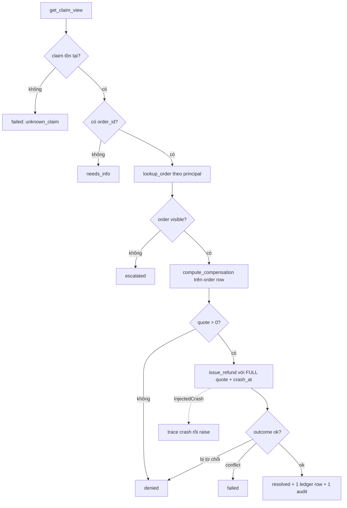

# Báo cáo cá nhân — Lê Thái Dương

## 1. Thông tin thành viên

- Họ tên: Lê Thái Dương
- MSSV: 2A202603415
- Email: `[điền email]`
- GitHub: `[điền username hoặc link GitHub]`

## 2. Phần việc phụ trách

- Shape được giao: **workflow (A)** — kiến trúc tuần tự, không để model quyết tiền.
- Dựng khung chung cho ba shape `workflow`, `single`, `orchestrator` trong CP2, sau đó hoàn thiện nhánh workflow trong CP3.
- Giữ nguyên chữ ký `run_claim(claim_id, *, seed, store_path, crash_at=None) -> RunResult`; mọi nhánh return đi qua `lab8.shapes.common.finish()`.
- Chuyển tiếp `crash_at` xuống `durability.issue_refund` và để `InjectedCrash` propagate.

### Luồng xử lý workflow

## 3. Đóng góp cụ thể

- Commit triển khai `27903a0` — `Implement CP2 and CP3 shapes and personal report`: viết ba shape, trong đó workflow là phần hoàn chỉnh nhất.
- Workflow đọc claim qua `get_claim_view`; thiếu `order_id` trả `needs_info`, order không thấy trả `escalated`, quote 0 trả `denied` và không gọi host.
- Quote lấy từ `compute_compensation(conn, order_view["order"])`; bỏ qua số ngày trễ ghi trong ticket.
- Gọi `issue_refund(conn, claim_id, proposal, crash_at=crash_at)` với quote đầy đủ; không tự trừ phần đã hoàn cho claim trước.
- Trace ghi `error`, `decision`, `lookup_order`, `quote`, `crash`; không ghi claim row thô, ticket, `parent_secret`, header, số điện thoại, địa chỉ, tên hàng hay ghi chú nội bộ.
- Commit cuối `bf25139` — `Fix personal report filename` (đổi tên báo cáo cá nhân).
- Test đã thêm hoặc sửa: chưa thêm test mới; xác minh bằng `tests/test_public_matrix.py` (T01–T14), `tests/test_trace_contract.py` và `tests/test_handoff_secret.py`.

## 4. Bằng chứng

- Commit: `27903a0` (code), `bf25139` (báo cáo).
- Shape workflow: pass rate `1.000`, pass^5 `1.000`, seed min–max `1.000–1.000`, variance `0.000000`, cost/success `27.86` VND, mean steps `1.86` (`src/reports/benchmark.json`).
- Run id dẫn chứng: `R-workflow-C-001-s11`.
- Crash suite: `crash_safety = 20/20` (`src/reports/crash.json`).
- Bộ student: `248 passed`; cổng host: `54 passed`.
- Handoff và trace contract: `9 passed`; T11/T12 retry và crash: `8 passed`.

## 5. Công cụ AI đã dùng

- Dùng Codex/ChatGPT để đọc `docs/contracts.md`, gợi ý cấu trúc triển khai và rà các nhánh return.
- Tự kiểm tra bằng cách đọc source/test, chạy pytest, chạy crash suite và đọc lại trace.
- Không dùng AI để bịa số liệu; mọi số trong báo cáo lấy từ output test và report thật.

## 6. Tự đánh giá

Hoàn thành shape workflow và khung chung CP2/CP3. Shape trả đúng `RunResult`, tôn trọng ranh giới host/model, không ghi secret vào trace và vượt qua các kiểm tra retry/crash. Phần cần hoàn thiện: điền email, GitHub và xác nhận commit chốt trước khi nộp.
