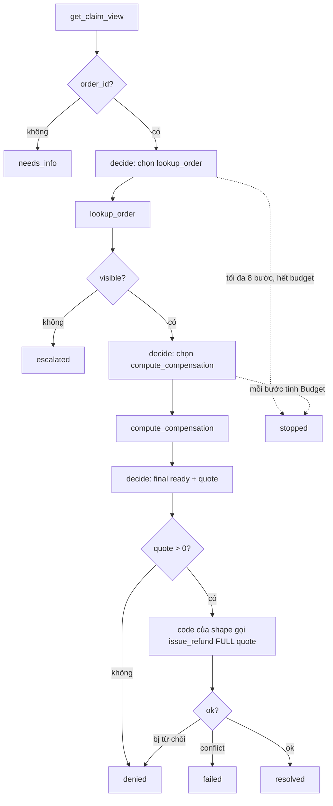

# Báo cáo cá nhân — Vũ Văn Hào

## 1. Thông tin thành viên

- Họ tên: Vũ Văn Hào
- MSSV: 2A202603419
- Email: `[điền email]`
- GitHub: `haovu1663-crypto`

## 2. Phần việc phụ trách

- Shape được giao: **single (B)** — vòng ReAct tối đa 8 bước, model chỉ chọn tool đọc.
- Rà soát ranh giới quyền: `decide` chỉ được gọi `lookup_order` và `compute_compensation`; không có quyền gọi `issue_refund`.
- Phụ trách CP4: crash suite 20/20, test durability, approval binding và rò rỉ secret/PII áp lên cả ba shape.

### Luồng xử lý single

## 3. Đóng góp cụ thể

- Commit `09e67f3` — `feat(cp4): add crash safety 20/20 report, security tests, and author report for Vu Van Hao`.
- Thêm `src/tests/test_cp4_durability_and_secrets.py` gồm ba nhóm kiểm tra:
  - Crash `after_effect_before_checkpoint` phục hồi đúng, chỉ một ledger row và một audit.
  - Approval gắn với `claim_id`, chặn dùng approval của claim khác.
  - Handoff và trace không lộ `CANARY_SECRET_`, `CANARY_INTERNAL_`, `parent_secret`, header hay số điện thoại.
- Cập nhật `src/reports/crash.json` với `crash_safety = 20/20`.
- Single tuân thủ: model chỉ đọc dữ liệu, code của shape kiểm quote 0 rồi gọi host với quote đầy đủ; mỗi bước model tính vào `Budget`.
- Test đã thêm hoặc sửa: `src/tests/test_cp4_durability_and_secrets.py`.

## 4. Bằng chứng

- Commit: `09e67f3` (nhánh `vuvanhao`).
- Test CP4: `src/tests/test_cp4_durability_and_secrets.py` — crash recovery, approval binding, secret leak.
- Crash suite: `crash_safety = 20/20` (`src/reports/crash.json`).
- Shape single: pass rate `1.000`, pass^5 `1.000`, seed min–max `1.000–1.000`, variance `0.000000`, cost/success `32.65` VND, mean steps `1.86`.
- Run id dẫn chứng: `R-single-C-001-s11`.
- Bộ student: `248 passed`; cổng host: `54 passed`.

## 5. Công cụ AI đã dùng

- Dùng AI để đọc `docs/contracts.md`, `docs/business_rules.md` và soạn khung test CP4.
- Tự kiểm chứng bằng cách chạy `python -m pytest -q tests/test_cp4_durability_and_secrets.py`, `python -m lab8.crash_test --count 20` và đọc lại `crash.json`.
- Không dùng AI để tạo số liệu; số liệu lấy từ report do lab tool sinh.

## 6. Tự đánh giá

Hoàn thành phần CP4 và test an toàn dữ liệu. Các test bắt được lỗi crash/approval/secret ở mức host, nên áp dụng được cho cả ba shape. Điểm cần cải thiện: bổ sung test riêng cho vòng ReAct của single (giới hạn 8 bước, budget) thay vì chỉ dựa vào matrix chung.
