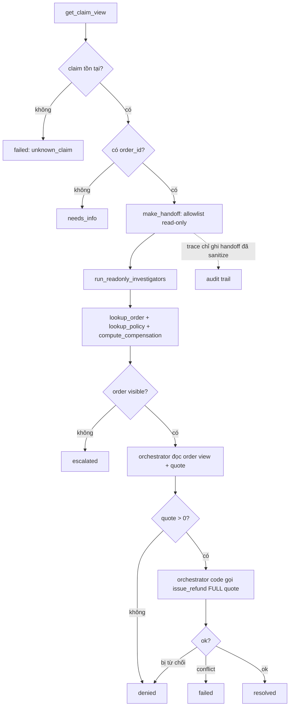

# Báo cáo cá nhân — Nguyễn Triều Dương

## 1. Thông tin thành viên

- Họ tên: Nguyễn Triều Dương
- MSSV: 2A202603524
- Email: `nguyentrieuduong0911@gmail.com`
- GitHub: `duongnt1`

## 2. Phần việc phụ trách

- Shape được giao: **orchestrator (C)** — handoff allowlist read-only, investigator không có write registry.
- Rà contract handoff: chỉ field trong allowlist của `lab8.handoff`; không chuyển `parent_secret`, claim row thô hay dữ liệu PII.
- CP1: cài môi trường, đọc contract và ghi chú xác minh baseline.

### Luồng xử lý orchestrator

## 3. Đóng góp cụ thể

- Commit `6faf794` — `docs: record CP1 setup verification and contract review`.
- Viết `report/team/cp1_setup.md`: baseline smoke, host gate, student matrix và tóm tắt contract.
- Ghi nhận baseline CP1 `186 failed, 62 passed` do ba shape còn stub, không phải lỗi môi trường.
- Rà nhánh orchestrator: không có write tool trong registry của investigator; handoff chỉ chứa field allowlist; trace chỉ ghi handoff đã sanitize, order view của investigator và quote.
- Test đã thêm hoặc sửa: chưa có test mới trong lịch sử nhánh; xác minh bằng `tests/test_handoff_secret.py` và `tests/test_public_matrix.py`.

## 4. Bằng chứng

- Commit: `6faf794`.
- File: `report/team/cp1_setup.md`.
- Shape orchestrator: pass rate `1.000`, pass^5 `1.000`, seed min–max `1.000–1.000`, variance `0.000000`, cost/success `46.43` VND, mean steps `2.79`, p95 steps `3.0`.
- Run id dẫn chứng: `R-orchestrator-C-001-s11`.
- Handoff và trace contract: `9 passed`.
- Bộ student: `248 passed`; cổng host: `54 passed`.

## 5. Công cụ AI đã dùng

- Dùng AI để đọc `README.md`, `docs/contracts.md`, `docs/business_rules.md` và tóm tắt contract.
- Tự kiểm chứng bằng cách chạy smoke, host gate và student matrix; số liệu lấy từ output thật, ghi trong `cp1_setup.md`.
- Không dùng AI để bịa số liệu.

## 6. Tự đánh giá

Hoàn thành CP1 và phần rà contract cho orchestrator. Baseline được ghi lại đúng thời điểm nên nhóm phân biệt được lỗi môi trường với stub. Điểm cần cải thiện: bổ sung test riêng cho handoff allowlist của orchestrator thay vì chỉ dựa vào test handoff dùng chung.
