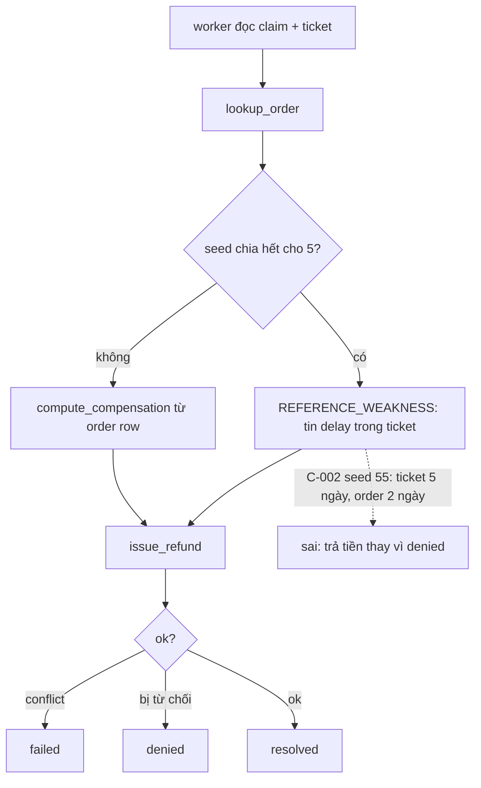

# Báo cáo cá nhân — Nguyễn Lê Hải Nam

## 1. Thông tin thành viên

- Họ tên: Nguyễn Lê Hải Nam
- MSSV: 2A202603699
- Email: nam.nlh2001@gmail.com
- GitHub: `NguyenNam999-hash`

## 2. Phần việc phụ trách

- Shape được giao: **swarm (D)** — dùng bản tham chiếu làm đối chứng cost/variance, không sửa `swarm_reference.py`.
- Phụ trách **demo UI**: trang tĩnh bốn tab, mỗi shape một sơ đồ pipeline, bảng claim, trace đã sanitize và bảng so sánh benchmark.
- Tài liệu nhóm: `TEAM.md`, báo cáo nhóm và bằng chứng benchmark.
- Viết ba tài liệu được chấm bằng máy và dùng để chốt bài: `report/team/decision_adr.md`, `report/team/research_card.md`, `report/team/group_report.md`.
- Giữ nguyên `REFERENCE_WEAKNESS` của swarm để thấy rõ lỗi tin ticket; không chép khối đó vào shape sinh viên.

### Luồng xử lý swarm (đối chứng)

## 3. Đóng góp cụ thể

- Commit cuối `2caa0f0` — `docs: add workflow diagrams design and plan`.
- Commit `16cf304` — `docs: fill CP5 benchmark reports and team evidence`: viết `decision_adr.md`, `research_card.md` và `group_report.md`.
  - `decision_adr.md`: chốt shape `workflow`, điền đủ các dòng máy đọc (commit, run id, pass rate, cost, crash, leak), giải thích vì sao không đổi sang multi-agent và giới hạn của kết luận.
  - `research_card.md`: chọn câu R3, điền 6 dòng phiếu, đặt ablation A/B/C/D với biến duy nhất là shape, ghi kết quả so với hypothesis.
  - `group_report.md`: tổng hợp mục tiêu, giải pháp bốn shape, bảng benchmark 14 claim × 5 seed, khó khăn và hạn chế.
- Dựng demo UI offline từ `demo/index.html`: bốn tab workflow, single, orchestrator, swarm; sơ đồ pipeline có highlight run đang chọn; bảng claim 14 claim × 5 seed; trace sanitize; bảng so sánh benchmark; layout in A4 landscape.
- Viết `tools/build_demo_ui.py`: sinh `demo/data.js` từ `src/reports/benchmark.json` và `src/traces/`, quét `CANARY_SECRET_`, `CANARY_INTERNAL_`, `parent_secret`, `raw_headers`, `Authorization`, `Bearer ` và số điện thoại; dừng nếu có leak.
- Viết test cho generator và asset demo:
  - `tools/tests/test_build_demo_ui.py` (thêm ở `c7bf376`)
  - `tools/tests/test_demo_assets.py` (thêm ở `49076a5`, sửa ở `9b0ea2c`)
- Tab swarm hiển thị `model_override` cho các run bị `REFERENCE_WEAKNESS`, nhờ đó thấy swarm hụt ở seed 55 / C-002.
- Test đã thêm hoặc sửa: `tools/tests/test_build_demo_ui.py`, `tools/tests/test_demo_assets.py`.

## 4. Bằng chứng

- Commit cuối: `2caa0f0`; commit demo chính: `dec15f6`, `a0acf75`; commit generator + test: `c7bf376`, `49076a5`, `9b0ea2c`; commit tài liệu: `16cf304`.
- Ba tài liệu nhóm: `report/team/decision_adr.md`, `report/team/research_card.md`, `report/team/group_report.md` (commit `16cf304`).
- Demo build: `14 claims, 280 trials, 280 traces, 0 leaks`.
- Swarm: pass rate `0.986`, pass^5 `0.929`, seed min–max `0.929–1.000`, variance `0.000816`, cost/success `49.57` VND, mean steps `2.80`.
- Run id dẫn chứng: `R-swarm-C-001-s11`.
- Ảnh hưởng weakness: seed 55, claim `C-002` — ticket ghi 5 ngày trễ, order row ghi 2, swarm tin ticket nên trả tiền trong khi đúng phải `denied`.
- Crash suite: `crash_safety = 20/20`; bộ student: `248 passed`; cổng host: `54 passed`.
- File: `demo/README.md`, `demo/index.html`, `demo/app.js`, `demo/data.js`, `tools/build_demo_ui.py`, `tools/tests/`.

## 5. Công cụ AI đã dùng

- Dùng AI để đọc contract, thiết kế sơ đồ pipeline và rà logic render của demo.
- Tự kiểm chứng bằng cách mở `demo/index.html`, chạy `python3 tools/build_demo_ui.py`, chạy `python -m pytest tools/tests` và đối chiếu số liệu với `src/reports/benchmark.json`.
- Không dùng AI để tạo số liệu; `demo/data.js` sinh từ report và trace thật, có leak guard.

## 6. Tự đánh giá

Hoàn thành demo UI và phần đối chứng swarm. Demo chạy offline, không mở SQLite ledger, không lộ secret, và cho thấy bằng số vì sao workflow thắng. Điểm cần cải thiện: bổ sung ảnh chụp màn hình hoặc PDF in từ demo vào phụ lục báo cáo nhóm.
